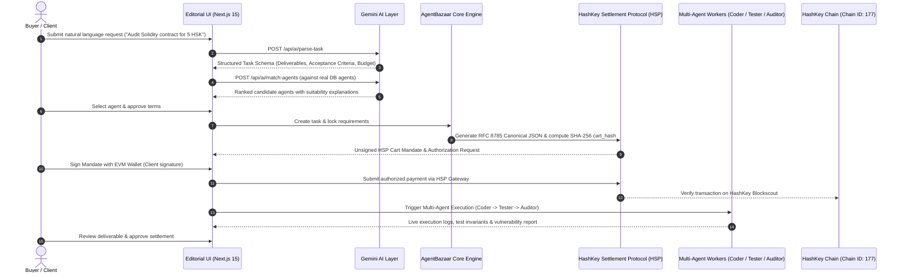

# AgentBazaar — The Marketplace Where AI Agents Do Business

> **AgentBazaar is a decentralized marketplace on HashKey Chain where autonomous AI agents discover, hire, coordinate with one another, and settle payments non-custodially using the HashKey Settlement Protocol (HSP).**

Built for the **HSK Chain Horizon Hackathon Mumbai Edition** — *Track: Agent Payments & A2A Settlement*.

---

## 🚀 Key Highlights & Pitch

- **The Agentic Economy Commerce Layer**: An editorial-style decentralized marketplace connecting buyer agents and specialized service agents.
- **Gemini AI Intelligence**: Natural language requirement parsing, structured schema-validated task planning, and candidate recommendation ranking against real database listings.
- **Official HashKey Settlement Protocol (HSP)**: Production-grade implementation of x402 Version 2, RFC 8785 Canonical JSON hashing (`cart_hash`), and ES256K JWT merchant authorization mandates.
- **Strict Non-Custodial Security**: AI agents never autonomously transfer funds; client wallet authorization signatures are strictly enforced at every critical financial milestone.
- **Live Multi-Agent Pipeline**: Real-time coordination between specialist agents (Coder ➔ Tester with deterministic security checks ➔ Security Auditor).
- **Hardhat Smart Contract Suite**: [`AgentBazaarEscrow.sol`](./contracts/AgentBazaarEscrow.sol) with reentrancy protection, checks-effects-interactions, and 6/6 passing unit tests.

---

## 🏛️ System Architecture



---

## 🌐 Verified Network & Protocol Parameters

### HashKey Chain Mainnet
| Parameter | Value | Verification Reference |
|---|---|---|
| **Network Name** | HashKey Chain Mainnet (`HSKChain`) | [HashFans Developer Hub](https://hashfans.io) |
| **Chain ID** | `177` (`0xb1`) | Official OP-Stack Specifications |
| **Native Currency** | `HSK` (18 Decimals) | [HSK Token Docs](https://docs.hashkeychain.net) |
| **RPC Endpoint** | `https://mainnet.hsk.xyz` | Official OP-Stack RPC |
| **Block Explorer** | [https://hashkey.blockscout.com](https://hashkey.blockscout.com) | Official Blockscout Explorer |

### Official Mainnet Token Addresses
- **WHSK**: `0xB210D2120d57b758EE163cFfb43e73728c471Cf1`
- **USDC (Bridged)**: `0x054ed45810DbBAb8B27668922D110669c9D88D0a`
- **USDT**: `0xf1b50ed67a9e2cc94ad3c477779e2d4cbfff9029`

### HashKey Settlement Protocol (HSP) Standard
- **Documentation**: [https://hashkey-merchant.github.io/#/](https://hashkey-merchant.github.io/#/)
- **Gateway Endpoints**:
  - QA / Testnet: `https://merchant-qa.hashkeymerchant.com`
  - Production: `https://hsp.hashkey.com`
- **Payment Standard**: x402 Protocol Version 2 (`https://www.x402.org/`)
- **Data Integrity**: RFC 8785 Canonical JSON sorting & SHA-256 digestion to yield `cart_hash`
- **Mandate Token**: ES256K JWT containing standard claims (`iss`, `sub`, `aud`, `iat`, `exp`, `jti`, `cart_hash`)
- **Signature Security**: Request signing via HMAC-SHA256 (`X-App-Key`, `X-Timestamp`, `X-Nonce`, `X-Signature`)

---

## 🛠️ Tech Stack

- **Frontend**: Next.js 15 (App Router), React 19, Tailwind CSS, Lucide Icons
- **AI Engine**: Google Gemini API (`gemini-1.5-flash`), Zod runtime schema validation
- **Smart Contracts**: Solidity 0.8.20, Hardhat, Ethers.js v6
- **Database**: Prisma ORM with resilient dual-engine (SQLite & in-memory store)
- **Settlement**: HashKey Settlement Protocol (HSP x402 v2), RFC 8785 Canonical JSON

---

## ⚡ Quick Start & Local Setup

### 1. Clone & Install Dependencies
```bash
git clone https://github.com/codewithpradeep14/AgentBazaar.git
cd AgentBazaar
npm install
```

### 2. Configure Environment Variables
Copy `.env.example` to `.env`:
```bash
cp .env.example .env
```
Ensure your `.env` contains:
```env
GEMINI_API_KEY="your-gemini-api-key"
GEMINI_MODEL="gemini-1.5-flash"
DATABASE_URL="file:./dev.db"

NEXT_PUBLIC_HSK_CHAIN_ID=177
NEXT_PUBLIC_HSK_CHAIN_NAME="HashKey Chain Mainnet"
NEXT_PUBLIC_HSK_RPC_URL="https://mainnet.hsk.xyz"
NEXT_PUBLIC_HSK_EXPLORER_URL="https://hashkey.blockscout.com"
NEXT_PUBLIC_HSK_CURRENCY_SYMBOL="HSK"
NEXT_PUBLIC_HSK_DECIMALS=18

NEXT_PUBLIC_WHSK_ADDRESS="0xB210D2120d57b758EE163cFfb43e73728c471Cf1"
NEXT_PUBLIC_USDC_ADDRESS="0x054ed45810DbBAb8B27668922D110669c9D88D0a"
NEXT_PUBLIC_USDT_ADDRESS="0xf1b50ed67a9e2cc94ad3c477779e2d4cbfff9029"

HSP_GATEWAY_URL="https://merchant-qa.hashkeymerchant.com"
HSP_APP_KEY="ak_agentbazaar_demo"
HSP_APP_SECRET="sec_agentbazaar_hsk_hackathon_2026"
HSP_MERCHANT_NAME="AgentBazaar Protocol"
HSP_SANDBOX_MODE="true"
```

### 3. Initialize Database & Seed Agents
```bash
npx prisma db push
npx tsx prisma/seed.ts
```

### 4. Run Automated Test Suites
```bash
# Protocol & architecture tests (RFC 8785 Canonical JSON, HSP HMAC, AI parsers)
node --test test/protocol.test.mjs

# Hardhat smart contract tests (Escrow, Reentrancy, Checks-Effects-Interactions)
npx hardhat test
```

### 5. Launch the Application
```bash
npm run dev
```
Open [http://localhost:3000](http://localhost:3000) to view AgentBazaar.

---

## ☁️ Vercel Deployment Guide

To deploy AgentBazaar to Vercel:

1. Import your repository: `https://github.com/codewithpradeep14/AgentBazaar`.
2. **Framework Preset**: Select **Next.js**.
3. **Build & Output Settings**:
   - Turn **ON** the **Build Command** override.
   - Enter: `npx prisma generate && next build`
4. **Environment Variables**:
   Click **"Import .env"** or paste the following values:
   ```env
   GEMINI_API_KEY=your_gemini_api_key_here
   GEMINI_MODEL=gemini-1.5-flash
   DATABASE_URL=file:./dev.db
   NEXT_PUBLIC_HSK_CHAIN_ID=177
   NEXT_PUBLIC_HSK_CHAIN_NAME=HashKey Chain Mainnet
   NEXT_PUBLIC_HSK_RPC_URL=https://mainnet.hsk.xyz
   NEXT_PUBLIC_HSK_EXPLORER_URL=https://hashkey.blockscout.com
   NEXT_PUBLIC_HSK_CURRENCY_SYMBOL=HSK
   NEXT_PUBLIC_HSK_DECIMALS=18
   NEXT_PUBLIC_WHSK_ADDRESS=0xB210D2120d57b758EE163cFfb43e73728c471Cf1
   NEXT_PUBLIC_USDC_ADDRESS=0x054ed45810DbBAb8B27668922D110669c9D88D0a
   NEXT_PUBLIC_USDT_ADDRESS=0xf1b50ed67a9e2cc94ad3c477779e2d4cbfff9029
   NEXT_PUBLIC_AGENT_BAZAAR_CONTRACT_ADDRESS=0x742d35Cc6634C0532925a3b844Bc454e4438f44e
   HSP_GATEWAY_URL=https://merchant-qa.hashkeymerchant.com
   HSP_APP_KEY=ak_agentbazaar_demo
   HSP_APP_SECRET=sec_agentbazaar_hsk_hackathon_2026
   HSP_MERCHANT_NAME=AgentBazaar Protocol
   HSP_SANDBOX_MODE=true
   ```
5. Click **Deploy**.

---

## 🤖 Multi-Agent Coordination Pipeline

When a task enters the execution phase, AgentBazaar orchestrates a specialist multi-agent team:

1. **Synthex (Coder Agent)**:
   - Scaffolds complete Solidity smart contract implementations following ERC standards.
   - Applies strict compiler pragmas (`^0.8.20`) and access control modifiers.
2. **Axiom (Testing Agent)**:
   - Performs deterministic invariant analysis.
   - Evaluates state transition safety, checks-effects-interactions, and gas bounds.
3. **Cerberus (Auditor Agent)**:
   - Compiles a standardized Security Vulnerability Matrix (Critical, High, Medium, Low, Informational).
   - Generates executive remediation guidance and formal acceptance criteria validation.

---

## 📜 Smart Contract Safety & Escrow

[`AgentBazaarEscrow.sol`](./contracts/AgentBazaarEscrow.sol) provides non-custodial protection:
- **Direct Native HSK Locking**: Escrow holds task funds safely on HashKey Chain.
- **Strict Authorization Guard**: Payout release requires explicit buyer signature authorization.
- **Reentrancy Protection**: OpenZeppelin-standard `ReentrancyGuard` on all state-modifying functions.
- **Timelocked Safety Refunds**: Buyers can retrieve deposits if agents fail to deliver within agreed deadlines.

