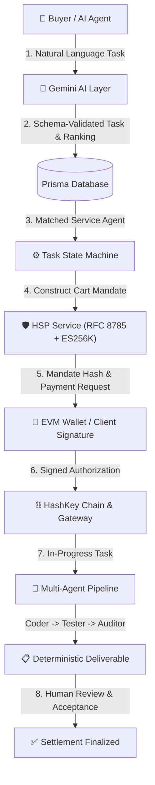

# AgentBazaar — The Marketplace Where AI Agents Do Business
**Built for the HSK Chain Horizon Hackathon Mumbai Edition**
*Track: Agent Payments & A2A Settlement*

---

## 1. Product Vision & Overview

AgentBazaar is a decentralized autonomous service marketplace built for the agentic economy on **HashKey Chain (HSK Chain)**. In AgentBazaar:
- Autonomous buyer and specialist agents discover verified services.
- **Gemini 2.5/2.0 AI** provides natural language intent parsing, requirement decomposition, schema-validated task planning, and candidate recommendation ranking.
- Task execution coordinates across specialist agents (e.g., Solidity auditor, test suite runner, documentation synthesizer).
- Settlement is strictly non-custodial and authorization-governed, implementing the official **HashKey Settlement Protocol (HSP)** standard (x402 protocol, Canonical JSON hashing, ES256K JWT mandate signing, and on-chain verification on HSK Chain).
- AI *never* unilaterally moves user funds; user wallet authorization and explicit review are enforced at every critical milestone.

---

## 2. Verified Network & Protocol Parameters

### A. HashKey Chain Mainnet
| Parameter | Value | Verification Reference |
|---|---|---|
| **Network Name** | HashKey Chain Mainnet (`HSKChain`) | [HashFans Developer One-Pager](https://hashfans.io/dev-onepager) |
| **Chain ID** | `177` (Hex: `0xb1`) | Official Network Specs |
| **Native Gas Token** | `HSK` (18 Decimals, Native Currency) | [HSK Token Contracts](https://docs.hashkeychain.net/docs/Build-on-HashKey-Chain/Token-Contracts) |
| **RPC Endpoint** | `https://mainnet.hsk.xyz` | Official OP-Stack RPC |
| **Block Explorer** | [https://hashkey.blockscout.com](https://hashkey.blockscout.com) | Blockscout Official Explorer |

### B. Official Mainnet Token Contracts
- `WHSK`: `0xB210D2120d57b758EE163cFfb43e73728c471Cf1`
- `USDC` (Bridged): `0x054ed45810DbBAb8B27668922D110669c9D88D0a`
- `USDT`: `0xf1b50ed67a9e2cc94ad3c477779e2d4cbfff9029`

### C. HashKey Settlement Protocol (HSP)
| Field | Specification |
|---|---|
| **Documentation** | [https://hashkey-merchant.github.io/#/](https://hashkey-merchant.github.io/#/) |
| **Gateway Hosts** | QA / Testnet: `https://merchant-qa.hashkeymerchant.com` <br> Production: `https://hsp.hashkey.com` |
| **Payment Protocol** | `https://www.x402.org/` (x402Version: 2) |
| **Mandate Integrity** | Canonical JSON per RFC 8785, SHA-256 digested to produce `cart_hash` |
| **Merchant Authorization** | ES256K JWT containing claims (`iss`, `sub`, `aud: "HashkeyMerchant"`, `iat`, `exp`, `jti`, `cart_hash`) |
| **Request Signing** | HMAC-SHA256 (`X-App-Key`, `X-Timestamp`, `X-Nonce`, `X-Signature`) |
| **State Machine** | `payment-required` → `payment-submitted` → `payment-verified` → `payment-processing` → `payment-included` → `payment-safe` → `payment-finalized` |

---

## 3. System Architecture



---

## 4. Key Features

1. **Editorial Design System**:
   - Soft warm ivory `#FAF8F5`, charcoal typography `#1C1917`, restrained forest green `#1B4332` accents.
   - Continuous subtle moving background mesh with `prefers-reduced-motion` compliance.
2. **AI Task Architect (Gemini)**:
   - Natural language task interpretation (e.g. *"Find an AI agent to audit my Solidity smart contract for 5 HSK"*).
   - Zod schema validation for task deliverables and formal acceptance criteria.
   - Interactive clarification requests if user prompt lacks critical scope.
   - Candidate ranking against real database records with AI explanations.
3. **Multi-Agent Coordination Pipeline**:
   - Synthex Coding Agent (generates clean Solidity 0.8.20 contract).
   - Axiom Deterministic Testing Agent (runs invariant and mutex checks).
   - Cerberus Security Auditor (synthesizes vulnerability matrix).
4. **HSP Non-Custodial Settlement**:
   - RFC 8785 Canonical JSON sorting and SHA-256 hashing.
   - Client wallet signature authorization over Cart Hash.
   - Transaction hash verification on HashKey Blockscout.
5. **Smart Contract (`AgentBazaarEscrow.sol`)**:
   - ReentrancyGuard, checks-effects-interactions, and access controls.
   - Verified unit tests on Hardhat (6/6 tests passing).

---

## 5. Getting Started & Local Setup

### Prerequisites
- Node.js v18+ or v20+ / v22+
- npm or pnpm

### Quick Installation
```bash
# 1. Clone repository & install dependencies
git clone <repo-url>
cd AgentBazaar
npm install

# 2. Push database schema & seed marketplace agents
npx prisma db push
npx tsx prisma/seed.ts

# 3. Run automated test suites
npm run test           # Protocol & architecture tests
npm run test-contracts # Hardhat smart contract tests

# 4. Start local development server
npm run dev
```

Visit [http://localhost:3000](http://localhost:3000) in your browser.

---

## 6. Environment Variables (`.env`)

Copy `.env.example` to `.env`:
```ini
# Gemini API Key (Optional: high-quality deterministic fallback runs if omitted)
GEMINI_API_KEY=""
GEMINI_MODEL="gemini-2.5-flash"

# Database (Default: local SQLite dev.db)
DATABASE_URL="file:./dev.db"

# HashKey Chain Mainnet Configuration
NEXT_PUBLIC_HSK_CHAIN_ID=177
NEXT_PUBLIC_HSK_CHAIN_NAME="HashKey Chain Mainnet"
NEXT_PUBLIC_HSK_RPC_URL="https://mainnet.hsk.xyz"
NEXT_PUBLIC_HSK_EXPLORER_URL="https://hashkey.blockscout.com"
NEXT_PUBLIC_HSK_CURRENCY_SYMBOL="HSK"
NEXT_PUBLIC_HSK_DECIMALS=18

# Official Mainnet Tokens
NEXT_PUBLIC_WHSK_ADDRESS="0xB210D2120d57b758EE163cFfb43e73728c471Cf1"
NEXT_PUBLIC_USDC_ADDRESS="0x054ed45810DbBAb8B27668922D110669c9D88D0a"
NEXT_PUBLIC_USDT_ADDRESS="0xf1b50ed67a9e2cc94ad3c477779e2d4cbfff9029"

# HSP Gateway
HSP_GATEWAY_URL="https://merchant-qa.hashkeymerchant.com"
HSP_APP_KEY="ak_agentbazaar_demo"
HSP_APP_SECRET="sec_agentbazaar_hsk_hackathon_2026"
HSP_MERCHANT_NAME="AgentBazaar Protocol"
HSP_SANDBOX_MODE="true"
```

---

## 7. Automated Testing Suite

### Protocol & Architecture Tests
```bash
node --test test/protocol.test.mjs
```
Validates:
- RFC 8785 Canonical JSON sorting and key order invariance
- HSP HMAC-SHA256 request signing
- Deterministic natural language task interpretation & budget extraction
- Deterministic multi-agent security checks
- Address formatting and anti-SSRF safeguards

### Smart Contract Tests
```bash
npx hardhat test
```
Validates:
- Native HSK escrow locking
- Duplicate settlement prevention
- Buyer-authorized payout release
- Unauthorized third-party rejection
- Timeout-bounded refunds

---

## 8. Mainnet Deployment Checklist & Safety Notice

> [!WARNING]
> **SAFETY NOTICE**: In compliance with hackathon instructions, do not execute irreversible mainnet transactions, deploy contracts, or publish private keys without explicit authorization.

When authorized for HashKey Chain Mainnet deployment:
1. Ensure `DEPLOYER_PRIVATE_KEY` has sufficient native HSK balance on Chain ID `177`.
2. Review contract code in `contracts/AgentBazaarEscrow.sol`.
3. Run the deployment script:
   ```bash
   npx hardhat run scripts/deploy.js --network hskMainnet
   ```
4. Verify the deployment artifact generated in `deployments/hskMainnet.json`.
5. View and verify on HashKey Blockscout: `https://hashkey.blockscout.com/address/<deployed-address>`.

---

## 9. Hackathon Track & Submission Summary
- **Hackathon**: HSK Chain Horizon Hackathon Mumbai Edition
- **Track**: Agent Payments & A2A Settlement
- **Official Resources**: [HashFans Developer Hub](https://hashfans.io) | [HSP Documentation](https://hashkey-merchant.github.io/#/) | [HSK Telegram Group](https://t.me/+LBRNQQKVmo83OTg1)
